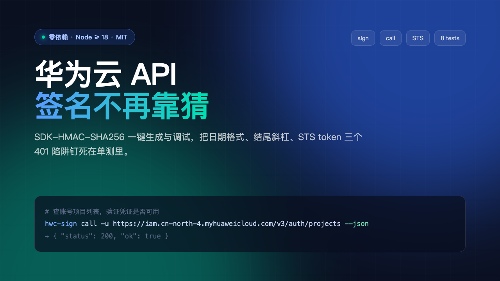

# hwc-sign



华为云 API 签名与调试 CLI。零依赖，只用 Node 内置模块，把华为云 **SDK-HMAC-SHA256** 签名算法和三个最容易踩的坑一起打包。

## 为什么需要它

华为云的签名文档看着跟 AWS SigV4 很像，但细节有三处不同。任何一处错了，接口只会回一句 **401**，而且错误信息不告诉你错在哪：

| 坑 | 错误表现 | 正确做法 |
|---|---|---|
| `x-sdk-date` 用了 ISO 格式 | `the time format is incorrect` | 必须是 `YYYYMMDDTHHMMSSZ`，不能带 `-` 和 `:` |
| CanonicalURI 没补结尾斜杠 | `verify ak sk signature failed`，并把你的 canonical_request 原样吐出来 | 路径必须补成 `/v3/auth/projects/` 这种以 `/` 结尾的形式 |
| STS 临时凭证漏了 security token | `verify ak sk signature failed` | 临时凭证要把 `x-security-token` **同时**放请求头并参与签名 |

这三个坑是我在接华为云 STS + 费用中心接口时逐个撞出来的，单测里各有一条用例钉住，防止以后改回旧写法。

## 安装

```bash
git clone https://github.com/bellafay/hwc-sign.git
cd hwc-sign
node bin/hwc-sign.mjs --help     # 无需 npm install，无第三方依赖
npm link                          # 可选：装成全局 hwc-sign 命令
```

要求 Node ≥ 18（用到内置 `fetch`）。

## 用法

### 1. 只算签名，不动网络

```bash
hwc-sign sign \
  -m GET \
  -u https://iam.cn-north-4.myhuaweicloud.com/v3/auth/projects \
  -a "$HWC_AK" -s "$HWC_SK"
```

输出可直接粘进 curl：

```
GET https://iam.cn-north-4.myhuaweicloud.com/v3/auth/projects
host: iam.cn-north-4.myhuaweicloud.com
x-sdk-date: 20261021T035053Z
Authorization: SDK-HMAC-SHA256 Access=***, SignedHeaders=host;x-sdk-date, Signature=...
```

### 2. 直接发请求

```bash
# 查账号下的项目列表（验证 AK/SK 是否有效的最快方式）
HWC_AK=xxx HWC_SK=yyy hwc-sign call \
  -u https://iam.cn-north-4.myhuaweicloud.com/v3/auth/projects --json
```

```json
{ "status": 200, "ok": true, "body": { "projects": [ ... ] } }
```

### 3. 用 STS 临时凭证换永久安全的调用方式

先自委托换临时凭证（需要 IAM 里存在一个信任本账号的委托）：

```bash
hwc-sign call -m POST \
  -u https://sts.cn-north-4.myhuaweicloud.com/v5/agencies/assume \
  -b '{
    "agency_urn": "iam::<账号ID>:agency:SELF_VERIFY",
    "agency_session_name": "demo-001",
    "duration_seconds": 900,
    "policy": "{\"Version\":\"5.0\",\"Statement\":[{\"Effect\":\"Allow\",\"Action\":[\"sts::GetCallerIdentity\"],\"Resource\":[\"*\"]}]}"
  }' --json
```

注意 `policy` 是 **字符串**不是对象——传对象会得到 `Json deserialize error: invalid type: map, expected a string`。

返回的临时凭证字段名是下划线风格，别按驼峰取：

```json
{ "credentials": {
    "access_key_id": "...",
    "secret_access_key": "...",
    "security_token": "...",
    "expiration": "2026-10-21T04:13:01.246Z"
} }
```

拿到之后带上 `--token`：

```bash
HWC_AK=<access_key_id> HWC_SK=<secret_access_key> hwc-sign call \
  --token <security_token> \
  -u https://sts.cn-north-4.myhuaweicloud.com/v5/caller-identity --json
```

## 参数

| 参数 | 说明 |
|---|---|
| `-u, --url` | 完整 URL，必填 |
| `-m, --method` | HTTP 方法，默认 `GET` |
| `-b, --body` | 请求体字符串；`GET`/`HEAD` 自动忽略 |
| `-a, --ak` / `-s, --sk` | 凭证，也可用环境变量 `HWC_AK` / `HWC_SK` |
| `--token` | STS security token，也可用 `HWC_TOKEN` |
| `--header` | 额外参与签名的头，如 `--header content-type:application/json`，可重复 |
| `--json` | 只输出 JSON，方便管道 |
| `--timeout` | 毫秒，默认 30000 |

退出码：`0` 成功，`1` 接口返回非 2xx，`2` 参数或凭证错误。

## 测试

```bash
npm test        # 等价于 node --test test/
```

8 条用例覆盖：日期格式、结尾斜杠、query 排序与编码、临时凭证注入、CanonicalRequest 六段结构、签名敏感性与稳定性、缺凭证报错。

## 已知边界

- 只实现 `SDK-HMAC-SHA256`（华为云当前主力算法），不含 AK-SK 的 `AK/SK` 旧算法与纯 Token 鉴权。
- 不处理 multipart 文件上传的签名（这类请求体哈希按空串签即可，用 `-m POST` 不带 `-b` 即可）。
- query 里的数组参数按单值处理，未做 `key=a&key=b` 之外的方言适配。

## License

MIT
